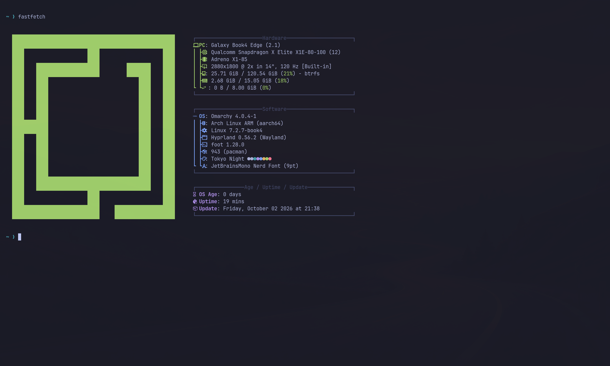

# Linux on the Samsung Galaxy Book4 Edge (14", Snapdragon X Elite)

Working notes, configuration, drivers and kernel patches for running Linux on
the **Samsung Galaxy Book4 Edge 14" (NP940XMA, X1E80100)**.

**How the reference machine runs (20 October 2026):** **Arch Linux ARM with
Omarchy** as the daily system, booted **at EL2** (Linux as its own
hypervisor, no Qualcomm Gunyah) with our sleep kernel `7.2.7-book4s`, which
reaches **full SoC deep sleep in s2idle with the audio DSPs running**
([docs/power.md](docs/power.md)). **Fedora** stays installed next to it on the
same disk as the build host: it owns `/boot` and GRUB, and Arch builds
kernels in a Fedora container. Both run kernels built from Anatase's
`anatase-7.2` tree plus our patches, published as
[n1c0la84/linux-book4-edge](https://github.com/n1c0la84/linux-book4-edge)
([docs/kernel.md](docs/kernel.md)).

- **Set it up from scratch:** [docs/install.md](docs/install.md)
- **Keep it updated:** [docs/updates.md](docs/updates.md)
- **Open points:** [docs/TODO.md](docs/TODO.md)

This builds on the **[Anatase](https://github.com/anatase-org/patchwork)**
project (branch `anatase-7.2`), whose device tree and EC/Type-C drivers we
use; on [justririll/x1e-sleep](https://github.com/justririll/x1e-sleep) for
deep sleep; and on Stephan Gerhold's qebspil and Nikita Travkin's slbounce
for EL2 ([CREDITS.md](CREDITS.md)).

## Status (20 October 2026, 14" model)

| Area | State | How |
|---|---|---|
| Boot from internal UFS | works | hand-built DTB via GRUB `devicetree`, `cutmem`, see [docs/bootstrap.md](docs/bootstrap.md) |
| Windows from the GRUB menu | works | Fedora's signed arm64 GRUB has no built-in `chainloader`; the hook copies `chain.mod` to `\EFI\book4\arm64-efi\` and the entry loads it |
| Display (eDP) | works | needs `samsung-emuec` loaded (it provides the USB-C DP bridges) |
| Keyboard | works | udev rule: [userspace/keyboard](userspace/keyboard) |
| Fn keys: brightness, volume | work | stock HID |
| Keyboard backlight | works (Anatase kernel) | Anatase's `samsung-galaxybook-ec` drives it via the `0xFF10` mailbox and handles the hotkey; our own `0x62` experiment blinks and is superseded ([docs/related-work.md](docs/related-work.md)) |
| Touchpad | works | stock |
| Wi-Fi (WCN7850) | works | specific firmware, [docs/firmware.md](docs/firmware.md) |
| Bluetooth | works | controller needs a public address: [userspace/bluetooth](userspace/bluetooth) |
| Battery / AC | works, incl. charging confirmed | Anatase `samsung-galaxybook-ec` (built into the Anatase kernel); `ene-kb9058-battery` via DKMS on the Fedora kernel |
| USB-C data, hot-plug | works | Anatase `samsung-emuec` |
| Charging, incl. hot replug at 20 V | works | `samsung-emuec` + [our retry patch](drivers/anatase/patches) |
| Speakers, all four (2 woofers + 2 tweeters) | works | default DTB with the tweeters ([sent to Anatase](https://github.com/anatase-org/kernel-anatase/issues/4)), UCM profile, PipeWire crossover (woofers above 120 Hz, tweeters highs only) + limiter; amplifier gain +12 dB since 30 October (about the Windows level, measured with the amplifiers' voltage/current feedback; no automatic speaker protection): [docs/audio.md](docs/audio.md) |
| Internal microphones | works | DMIC0/1, gain raised in the UCM profile |
| Headphones, headset mic | profile present, untested | |
| Suspend (s2idle): lid close/open, power key | **full SoC deep sleep at EL2** (`aosd`/`cxsd`/`ddr` 97.5-99.9 % of the time asleep; 1.55 W measured without the DSPs, with them still to measure); at EL1 about 3.1-3.8 W, the SoC never reaches deep sleep | EL2 + `el1tmr` + the 7.3 PDC/LPASS/geni fixes + the boot votes released at boot (`book4-el2-sleep.service`): [docs/power.md](docs/power.md), set up by [install/el2/sleep-setup.sh](install/el2/sleep-setup.sh). Plugging in or unplugging the charger during sleep is fine since 4 October with [our patch 0002](drivers/anatase/patches) |
| `deep` suspend | never resumes | do not use |
| Linux at EL2 (KVM, no Qualcomm hypervisor) | **works, the default boot** | from the internal ESP, no stick: UEFI Shell + [qebspil](https://github.com/stephan-gh/qebspil) (starts the ADSP/CDSP; Linux attaches) + [slbounce](https://github.com/TravMurav/slbounce) before GRUB; audio, battery, USB-C, EFI variables and the RTC work: [docs/el2.md](docs/el2.md) |
| Hibernation | set up, **resume resets the machine** (EL1); not available at EL2 | swap file + `HibernateLocation`; not in use: [docs/TODO.md](docs/TODO.md) |
| External monitor (USB-C DisplayPort, HDMI) | not tested yet | DT and `samsung-emuec` support DP alt-mode; HDMI goes through an `rtd2171` bridge (`simple_bridge`) |
| Touchscreen | works (KDE Plasma, Anatase kernel) | Goodix `27C6:0123` via `i2c_hid_of`: a direct-touch multitouch device (`INPUT_PROP_DIRECT`, MT slots), which KWin uses as touch. Our earlier "no touch input" came from reading the `mouse0` handler and the two "UNKNOWN" interfaces; GNOME and the Fedora kernel not re-checked |
| Webcam | **works, experimental** (Anatase kernel + camera DTB) | OV02C10 on CCI0, CAMSS, libcamera software ISP: first frames 2 October, 1920x1092 at ~40 fps. Works in Chrome via PipeWire (one flag). Privacy LED (TLMM 110) lights while streaming. Default on the reference machine via `/etc/book4/default-dtb`: [docs/camera.md](docs/camera.md) |
| Fingerprint reader | **works, experimental** (Fedora; sudo confirmed, lock screen waits for it) | EgisTec `1c7a:05a1` in the power button, on `usb_2` ([dts/patches/0004](dts/patches)); needs libfprint with SDCP (unmerged MR !547, built by [install/fingerprint-libfprint.sh](install/fingerprint-libfprint.sh)), then [install/fingerprint.sh](install/fingerprint.sh). Rest the finger, do not click: [docs/TODO.md](docs/TODO.md) |
| EFI variables / NVRAM boot entries | works (Anatase kernel; at EL2 since 21 October with SHM bridges owned by Linux, sleep-backport 0027/0028) | QSEECOM allowlist; 197 variables, `efibootmgr` reads the boot order; not working on the Fedora kernel |
| RTC | works (Anatase kernel; at EL2 since 21 October), but loses time if the battery runs flat | kept in UTC (offset in the `RTCInfo` EFI variable); sets the system clock 1.9 s into boot, before the network; Windows needs `RealTimeIsUniversal=1`, see [docs/kernel.md](docs/kernel.md) |

**Who else is working on this machine**, what they already have and what is
genuinely ours: [docs/related-work.md](docs/related-work.md).
**Arch / Omarchy** on this machine: [docs/arch.md](docs/arch.md),
[docs/omarchy.md](docs/omarchy.md). **EL2**: [docs/el2.md](docs/el2.md).
**The kernel**: [docs/kernel.md](docs/kernel.md); what we send or could send
upstream: [docs/upstream.md](docs/upstream.md).

## Layout

    docs/            how it works, how we got here, who else is working on it;
                     install.md (from scratch) and updates.md (staying current)
    dts/             the device trees we boot, and the EL2 overlay (dts/src)
    drivers/
      anatase/       Anatase's battery + Type-C drivers, pristine, plus our patches (DKMS)
      book4-ec/      our own EC battery driver: superseded, kept as a record
      book4-kbd-backlight/  keyboard backlight driver: experimental, disabled
    userspace/       boot hook, udev/modprobe/dracut snippets, Bluetooth, audio, Omarchy patches
    install/         Fedora: install-fedora.sh, install-anatase-kernel.sh, guard-grub.sh, ...
      arch/          Arch Linux ARM and Omarchy in a second btrfs subvolume, boot entries
      el2/           EL2 boot chain on the ESP, the daily deep-sleep setup
    tools/
      kernel/        the sleep kernel: backported patches and build scripts
      power/         suspend/deep-sleep tools and the out-of-tree sleep modules
      experiments/   the one-off tests of October 2026 (a record, not maintained)
      ec/, audio/, display/, backup/   smaller tools
    (firmware)       nothing shipped: docs/firmware.md says what to extract from Windows
    LICENSES/        full licence texts (see LICENSE)

## Credits

Much of what works here is other people's work, above all the
[Anatase](https://github.com/anatase-org/patchwork) project (Antheas
Kapenekakis), Maxim Storetvedt's DTS series, Linaro's X1E80100 audio work
and the linux-firmware/Debian packagers. **[CREDITS.md](CREDITS.md) lists every
file taken from elsewhere with its origin, author, licence and whether we
changed it**, and separates that from our own work.

## Licence

Our code and scripts are **GPL-2.0-only**, our documentation **CC BY 4.0**;
files taken from others keep their own licences and copyright headers
(Anatase's drivers GPL-2.0-only, the UCM profile BSD-3-Clause from
alsa-ucm-conf). Details in [LICENSE](LICENSE) and [CREDITS.md](CREDITS.md).
